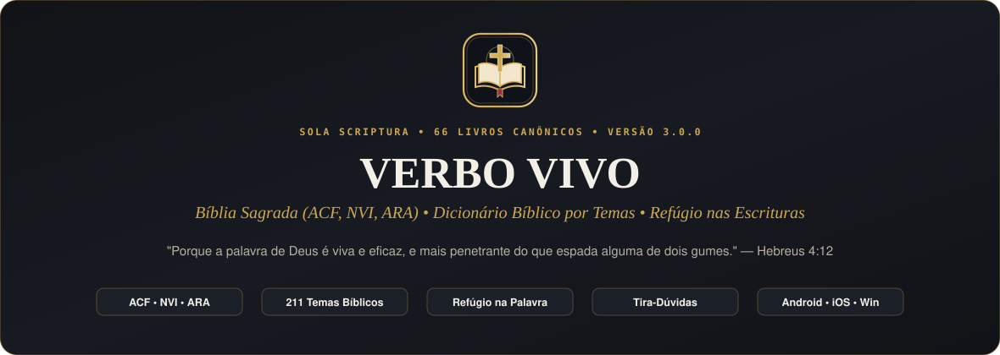

  <a href="https://carlosguedes-dev.github.io/verbo-vivo/">
    <picture>
      <source media="(prefers-color-scheme: dark)" srcset="./dark.svg">
      <source media="(prefers-color-scheme: light)" srcset="./light.svg">
      
    </picture>
  </a>

# Verbo Vivo — Aplicativo Oficial (Android, iPhone & Windows)

**Bíblia Sagrada 100% offline nas 3 traduções (ACF, NVI e ARA), Dicionário Bíblico temático respondido exclusivamente com versículos, Refúgio nas Escrituras, Tira-Dúvidas e Marcações pessoais.**

[-8e2934?style=for-the-badge)](https://carlosguedes-dev.github.io/verbo-vivo/)

---

### [Acessar a Página Oficial de Download (Android, iPhone e Windows)](https://carlosguedes-dev.github.io/verbo-vivo/) • [Abrir WebApp](https://carlosguedes-dev.github.io/verbo-vivo/app.html)

---

## Downloads Oficiais por Plataforma

| Plataforma | Formato | Link Direto de Download |
| :--- | :--- | :--- |
| **Android** | Pacote `.APK` | **[Baixar Verbo-Vivo-Android.apk](https://github.com/carlosguedes-dev/verbo-vivo/releases/latest/download/Verbo-Vivo-Android.apk)** |
| **iPhone / iOS** | Pacote `.IPA` & WebApp | **[Baixar Verbo-Vivo-iOS.ipa](https://github.com/carlosguedes-dev/verbo-vivo/releases/latest/download/Verbo-Vivo-iOS.ipa)** • **[Instalar na Tela de Início (iOS)](https://carlosguedes-dev.github.io/verbo-vivo/app.html)** |
| **Windows (10/11)** | Instalador `.EXE` & Portátil | **[Baixar Instalador Windows (.EXE)](https://github.com/carlosguedes-dev/verbo-vivo/releases/latest/download/Verbo-Vivo-Windows-Setup.exe)** • **[Versão Portátil (.EXE)](https://github.com/carlosguedes-dev/verbo-vivo/releases/latest/download/Verbo-Vivo-Windows-Portable.exe)** |

---

## Sobre o Aplicativo

O **Verbo Vivo** é um aplicativo cristão multiplataforma (**Android**, **iPhone/iOS**, **Windows** e **Web**) voltado para leitura clara, reverente e sem distrações das Sagradas Escrituras.

Todo o texto integral de **3 traduções consagradas em português (ACF, NVI e ARA)** — **66 livros canônicos**, **1.189 capítulos** e mais de **31.100 versículos** — funciona **100% embarcado e offline**, sem anúncios e sem coleta de dados.

---

## Principais Funcionalidades

- **Bíblia Sagrada Completa (ACF, NVI e ARA)**:
  - Seletor visual de livros por divisão bíblica e grade de capítulos.
  - Troca global de tradução no cabeçalho (atualiza a Bíblia, o Dicionário, o Refúgio e o Tira-Dúvidas simultaneamente).
  - Comparador instantâneo lado a lado entre **ACF**, **NVI** e **ARA** ao tocar em qualquer versículo.
  - Busca por palavras-chave ou referências diretas (ex.: `João 3:16`, `Sl 23:1-6`, `Jó 1:1`).
  - Contexto histórico e mensagem de cada um dos 66 livros sob demanda.
  - Controle de tamanho da fonte (`A-` / `A+`) e marcação de capítulos lidos.

- **Dicionário Bíblico Temático (211 temas, índice A–Z)**:
  - Consulte o que a Bíblia diz sobre aborto, amor, casamento, divórcio, ansiedade, depressão, dinheiro, dívidas, perdão, salvação, família, trabalho, governo, ética e centenas de outros temas.
  - **Respondido exclusivamente com versículos bíblicos**, extraídos diretamente da tradução ativa (ACF, NVI ou ARA), sem comentários humanos ou opiniões.
  - Busca por sinônimos, categorias temáticas, índice A–Z, cópia rápida e link direto para ler cada passagem no capítulo completo.

- **Refúgio nas Escrituras**:
  - Acesso imediato a passagens bíblicas para 12 situações reais da vida (ansiedade, arrependimento, cansaço, solidão, luto, decisões difíceis, tentação, tristeza, enfermidade, injustiça, incerteza e gratidão) — exibindo apenas a Palavra de Deus.

- **Tira-Dúvidas Bíblico**:
  - Estudos diretos sobre salvação, vida cristã, doutrina, apologética, família e eternidade, acompanhados das referências bíblicas clicáveis.

- **Minhas Marcações**:
  - Grife versículos em 4 categorias (Promessa, Doutrina, Sabedoria e Adoração) e salve anotações pessoais com filtros locais no seu dispositivo.

- **Interface Multiplataforma (Modo Escuro & Modo Claro)**:
  - Navegação superior no desktop (Windows/Web) e barra inferior nativa no celular (Android/iOS) com suporte a áreas seguras (`safe-area-inset`).
  - Painel de estudo lateral no computador e gaveta deslizável (bottom sheet) no celular.

---

## Arquitetura Multiplataforma

- **TypeScript 5.8 + Vite 6**: Empacotamento de alta performance para o App (`app.html`) e o Site de Download (`index.html`).
- **Capacitor 7 (`android/` & `ios/`)**: Empacotamento nativo para **Android (`.apk`)** e **iPhone / iOS (`.ipa`)**.
- **Electron 34 + Electron Builder (`electron/`)**: Aplicativo desktop nativo para **Windows 10/11 (`.exe` Instalador NSIS e Portátil)**.
- **GitHub Actions CI/CD (`.github/workflows/deploy.yml`)**: Executa testes de integridade, publica o site no GitHub Pages e compila automaticamente os pacotes nativos para o **GitHub Releases**.

---

## Licença

Distribuído sob a licença **MIT**. Veja [LICENSE](LICENSE) para mais detalhes.

---

  
Desenvolvido por <a href="https://github.com/carlosguedes-dev"><b>Carlos Guedes</b></a>

  
<i>"Porque dele e por ele, e para ele, são todas as coisas; glória, pois, a ele eternamente. Amém." — Romanos 11:36</i>

