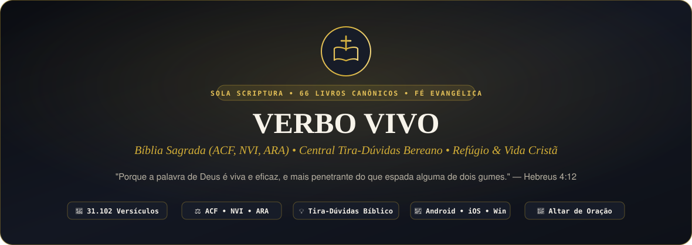

<div align="center">
  <a href="https://carlosguedes-dev.github.io/verbo-vivo/">
    <picture>
      <source media="(prefers-color-scheme: dark)" srcset="./dark.svg">
      <source media="(prefers-color-scheme: light)" srcset="./light.svg">
      
    </picture>
  </a>
</div>

<div align="center">

# ✝️ Verbo Vivo — Plataforma Cristã Evangélica Completa

**Bíblia Sagrada Integrada nas 3 Traduções (ACF, NVI, ARA), Central Tira-Dúvidas Bereano, Refúgio Bíblico, Devocional Cristocêntrico, Planos de Leitura, Os Cinco Solas, Harpa Cristã e Caderno de Oração!**

[](https://github.com/carlosguedes-dev/verbo-vivo)
[](LICENSE)
[-8b2635?style=for-the-badge)](https://carlosguedes-dev.github.io/verbo-vivo/)
[](https://www.typescriptlang.org/)
[](https://vitejs.dev/)
[](https://carlosguedes-dev.github.io/verbo-vivo/)

---

### 👉 **[Acessar o Projeto Ao Vivo / Santuário Digital Online](https://carlosguedes-dev.github.io/verbo-vivo/)**

</div>

---

## 📖 Sobre o Projeto

O **Verbo Vivo** é um santuário e ecossistema digital cristão evangélico projetado com excelência de engenharia e fidelidade bíblica inegociável (*Sola Scriptura*). Ele reúne em uma única aplicação web rápida, responsiva e 100% livre de distrações tudo o que o cristão precisa para examinar as Escrituras diariamente, tirar dúvidas sinceras de fé, encontrar consolo espiritual e organizar sua vida devocional.

Construído sobre a ortodoxia cristã histórica e reformada/evangélica — reconhecendo os **66 livros divinamente inspirados** (39 no Antigo Testamento e 27 no Novo Testamento) e a suficiência absoluta de **Jesus Cristo** como único Mediador e Salvador —, o projeto funciona **100% embarcado com o texto integral de 3 traduções consagradas da Bíblia Sagrada em português**, sem depender de APIs externas instáveis.

---

## ✨ Principais Funcionalidades

- 📖 **Bíblia Sagrada Completa nas 3 Traduções Evangélicas (ACF, NVI e ARA)**:
  - Todos os **66 livros canônicos**, **1.189 capítulos** e mais de **31.100 versículos** disponíveis instantaneamente.
  - **Comparador Simultâneo de Traduções**: Clique em qualquer versículo para compará-lo lado a lado na **ACF** (*Almeida Corrigida Fiel*), **NVI** (*Nova Versão Internacional*) e **ARA** (*Almeida Revista e Atualizada*).
  - **Panorama Teológico & Cristocêntrico dos 66 Livros**: Autor, data aproximada, divisão canônica, tema central, versículo-chave, resumo e **como Jesus Cristo é revelado naquele livro** (Lucas 24:27).
  - **Busca Global Inteligente**: Pesquise por palavras-chave (*"graça"*, *"bom pastor"*, *"fé"*) ou referências diretas (*"João 3:16"*, *"Salmos 23"*, *"Romanos 8"*).
  - **Marca-Texto Bíblico em 4 Cores + Notas Pessoais**: Destaque versículos por tema (Promessa, Doutrina, Sabedoria, Adoração) e salve suas meditações pessoais.

- 💡 **Central Tira-Dúvidas Bereano & Apologética Evangélica (Atos 17:11)**:
  - Respostas teológicas profundas, pastorais e 100% fundamentadas na Palavra de Deus para as dúvidas reais dos cristãos:
    - **Salvação & Graça**: Certeza da salvação, o que é a blasfêmia contra o Espírito Santo, a harmonia entre Fé e Obras (Paulo e Tiago) e o Novo Nascimento.
    - **Vida Cristã & Santificação**: Como vencer a luta contra o pecado, o que a Bíblia diz sobre ansiedade e depressão, como ouvir a voz de Deus, como lidar com a frieza espiritual e o verdadeiro perdão bíblico.
    - **Doutrina & Teologia**: Explicação clara da Santíssima Trindade, por que a Bíblia evangélica possui 66 livros (sem livros apócrifos), Cristo como único Mediador (1 Timóteo 2:5), Batismo nas Águas, Santa Ceia e o que acontece após a morte.
    - **Apologética & Dificuldades Bíblicas**: O problema do mal e do sofrimento, a confiabilidade histórica dos manuscritos bíblicos, a esposa de Caim e a harmonia entre Fé cristã e Ciência.
    - **Família, Jovens & Vocação**: Namoro cristão e jugo desigual, liberdade cristã no entretenimento, mordomia financeira (dízimos e ofertas sem legalismo) e a importância de congregar na igreja local.
    - **Escatologia & Eternidade**: A bendita esperança da volta de Jesus e o Tribunal de Cristo (*Bema*).

- 🕊️ **Refúgio Bíblico ("Para Onde Ir Quando...")**:
  - Socorro espiritual imediato para 8 estados reais da alma (Ansiedade, Arrependimento, Cansaço, Solidão, Luto, Decisão Difícil, Tentação e Gratidão), trazendo palavra pastoral, oração guiada e versículos clicáveis.

- 🌿 **Devocional Diário ("Pão Diário") & Planos de Leitura com Progresso**:
  - Meditações cristocêntricas com contexto histórico, aplicação prática e oração.
  - Planos guiados (*Jornada no Evangelho de João*, *Fundamentos da Graça em Romanos e Efésios*, *Sabedoria nos Salmos e Provérbios*) e rastreador dos 1.189 capítulos da Bíblia.

- 🏛️ **Pilares da Sã Doutrina & Harpa Cristã**:
  - Exposição dos **Cinco Solas da Reforma** (*Sola Scriptura, Solus Christus, Sola Gratia, Sola Fide, Soli Deo Gloria*), **Credo Apostólico**, **Dicionário Teológico Descomplicado** e letras completas de hinos históricos da **Harpa Cristã** (*Porque Ele Vive*, *Grandioso És Tu*, *Alvo Mais que a Neve*, *A Mensagem da Cruz*, *Castelo Forte*, *Mais Perto Quero Estar*, *Firme nas Promessas*, *Chuvas de Graça*).

- 🙏 **No Secreto (Mural de Oração & Caderno Bíblico — Mateus 6:6)**:
  - Caderno pessoal para registrar pedidos de oração, marcar **Orações Respondidas (Testemunhos)** e revisar todos os versículos grifados e anotados.

- ☀️/🌙 **Design "Santuário Editorial" (Modo Vigília Escuro & Modo Pergaminho Claro)**:
  - Tipografia literária de alta legibilidade (*Cormorant Garamond*, *Lora*, *Plus Jakarta Sans* e *JetBrains Mono*) com controle de tamanho de fonte (`A-` / `A+`).

---

## 🛠️ Tecnologias e Segurança Arquitetural

- **TypeScript 5.8 (Strict Mode)**: Tipagem estática rigorosa em todos os modelos bíblicos, serviços de busca e persistência.
- **Vite 6**: Empacotamento ultrarrápido e otimizado para produção.
- **Renderização DOM 100% Segura (Zero `innerHTML`)**: Toda a interface dinâmica é construída com `document.createElement` e `textContent`, prevenindo qualquer vetor de DOM XSS.
- **Suíte Automatizada de Integridade (`node:test`)**: Valida os 66 livros, 1.189 capítulos e +31.100 versículos nas 3 traduções, além da integridade dos módulos doutrinários.
- **GitHub Actions (CI/CD)**: Pipeline automatizada em `.github/workflows/deploy.yml` que executa os testes, compila o projeto e publica no GitHub Pages.

---

## 📂 Estrutura de Arquivos

```text
verbo-vivo/
├── .github/workflows/deploy.yml   # Pipeline CI/CD para publicação no GitHub Pages
├── public/
│   ├── favicon.svg                # Emblema vetorial da Cruz e Bíblia Aberta
│   └── data/
│       ├── acf.json               # Bíblia Completa Almeida Corrigida Fiel (66 livros)
│       ├── nvi.json               # Bíblia Completa Nova Versão Internacional (66 livros)
│       └── aa.json                # Bíblia Completa Almeida Revista e Atualizada (66 livros)
├── src/
│   ├── types/index.ts             # Contratos e interfaces TypeScript
│   ├── data/
│   │   ├── books-metadata.ts      # Panorama teológico e cristocêntrico dos 66 livros
│   │   ├── tira-duvidas.ts        # Base Bereana de perguntas e respostas bíblicas
│   │   ├── refugio-biblico.ts     # "Para Onde Ir Quando..." (Socorro espiritual)
│   │   ├── devocionais.ts         # Meditações cristocêntricas diárias
│   │   ├── planos-leitura.ts      # Planos estruturados de leitura bíblica
│   │   ├── doutrina-solas.ts      # Os 5 Solas, Credo Apostólico e Dicionário Teológico
│   │   └── harpa-louvores.ts      # Clássicos da Harpa Cristã e Hinologia Evangélica
│   ├── services/
│   │   ├── bible-service.ts       # Motor de busca bíblica e comparador de versões
│   │   ├── qa-engine.ts           # Motor semântico para o Tira-Dúvidas
│   │   └── storage-service.ts     # Persistência local de grifos, notas, planos e orações
│   ├── main.ts                    # Controlador principal da aplicação
│   └── style.css                  # Design System Santuário Editorial (Vigília & Pergaminho)
├── tests/
│   └── integrity.test.mjs         # Testes automatizados de integridade canônica e segurança
├── index.html                     # Marcação semântica principal
├── package.json                   # Scripts e dependências
└── README.md                      # Documentação oficial
```

---

## 🚀 Como Executar Localmente

1. **Clone o repositório:**
   ```bash
   git clone https://github.com/carlosguedes-dev/verbo-vivo.git
   cd verbo-vivo
   ```

2. **Instale as dependências:**
   ```bash
   npm install
   ```

3. **Execute os testes de integridade bíblica e segurança:**
   ```bash
   npm test
   ```

4. **Inicie o servidor de desenvolvimento:**
   ```bash
   npm run dev
   ```

5. **Gere o build otimizado para produção:**
   ```bash
   npm run build
   ```

---

## 📜 Licença

Distribuído sob a licença **MIT**. Veja o arquivo [LICENSE](LICENSE) para mais detalhes.

---

<div align="center">
  <p>Desenvolvido com reverência, dedicação e engenharia de precisão por <a href="https://github.com/carlosguedes-dev"><b>Carlos Guedes</b></a></p>
  <p><i>"Porque dele e por ele, e para ele, são todas as coisas; glória, pois, a ele eternamente. Amém." — Romanos 11:36</i></p>
</div>
